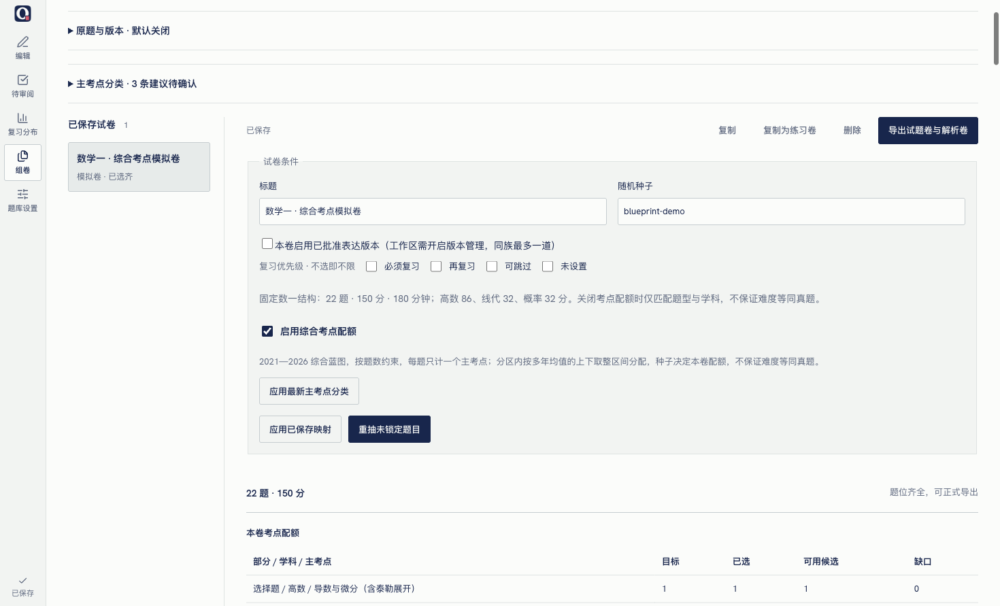
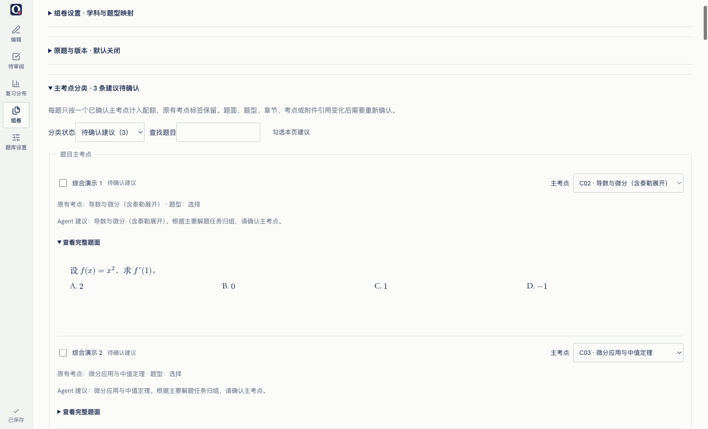
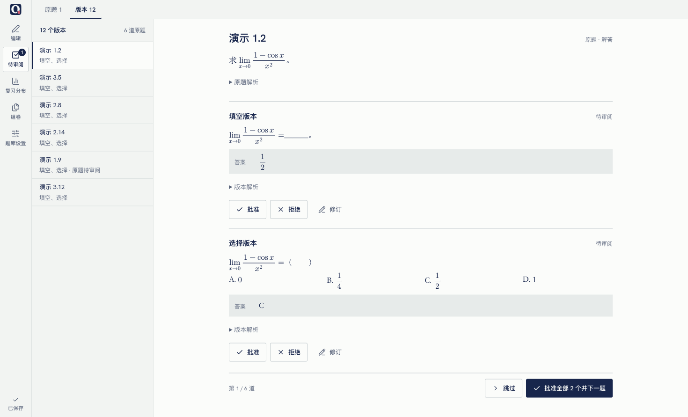

# 组卷

在导航中打开「组卷」。试卷与题库独立保存，已有 v4 题库无需迁移。

## 模拟卷

固定使用已核对的 2021 至 2026 年数学一共同结构，不提供年份或模板选择，未核对 2012 至 2020 年。2026 年依据机构发布的真题解析核对，非官方发布稿。

| 部分 | 题号与学科 | 分值 |
| --- | --- | --- |
| 选择 | 1–4 高数，5–7 线代，8–10 概率 | 每题 5 分 |
| 填空 | 11–14 高数，15 线代，16 概率 | 每题 5 分 |
| 解答 | 17–20 高数，21 线代，22 概率 | 17 题 10 分，其余 12 分 |

共 22 题、150 分、180 分钟；高数 86 分、线代 32 分、概率 32 分。题位分值固定，题库没有题目分值字段，入卷后按题位计分。证明归入解答部分。新建模拟卷默认开启综合考点配额，额外约束主考点；取消勾选后只约束题型、学科与题位分值。不保证难度等同真题。

先展开「组卷设置」，将章节明确映射到三个学科。不会按章节名称推断；未映射及未分类题不进入模拟卷。标准题型「选择、填空、解答、证明」有默认归类，其他名称可配置。若一道题的多个题型跨不同部分，该题会被排除并提示整理。组卷不会修改题面。

可多选复习优先级，清空表示不限。所有卷种均只使用已批准题。

## 练习卷

默认 10 道选择、6 道填空、6 道解答，不设学科配额。章节、考点、书目均可多选或清空；同一字段内满足任意值，不同字段之间须同时满足。题量可分别调整，总题量 1 至 200，每部分最多 100。

选择和填空默认每题 5 分，首道解答默认 10 分，其余 12 分；支持逐题调整 1 至 150 分。减少题量会确认并移除该部分末尾题位。已选题不会因条件、映射或种子改变而自动替换，不符合新规则的题位会标记。

## 选题与编辑

「重抽未锁定题目」保留锁定题，先满足题位约束，再选与当前已选题考点重合较少的候选，并以种子打破并列。相同题库、规则、种子及锁题状态可复现。每个原题 ID 在同卷只能出现一次；单题替换和手动选入排除当前题及其余入卷题。没有合适候选时不会重复或放宽条件。

缺题也会保存成草稿，按题位显示部分与学科。可改条件、补题或复制为练习卷。缺题、重复题或规则冲突会禁用正式导出。支持复制、打开和确认删除。删除保留附件及 `.bak`，因为副本、备份可能仍引用这些不可变附件。

试卷与映射自动保存，队列保持单飞并合并后续编辑。关闭、切换工作区和另存前等待保存；失败保留内存草稿并阻止关闭/切换。核对后可重试；试卷冲突可选择载入磁盘版本，载入前会确认放弃本地草稿。跨工作区另存会复制试卷、映射、附件及备份。

## 快照与导出

新选题由服务端按指定题库 revision 读取，复制题目与经校验的附件。原题 ID 用于追溯，来源文案、题面、解析、备注与附件均属于快照。源题被编辑、删除或源附件丢失不影响已存试卷。旧卷保留自身映射规则；主动点击「应用已保存映射」才能更新。

导出使用保存后的固定快照，生成 `questions.pdf`、`full.pdf`、两份 TeX 和 `sources.md`。试题卷不含解析、备注或来源；解析卷包含题面和解析，缺解析明确标记。A4 单栏，分节、题号、分值、页码齐全；10 道选择、6 道填空、6 道解答且合计 150 分的标准整卷显示 180 分钟。解答题默认半页留白，可逐题选择紧凑或整页；长题自然分页。试卷同时保存建卷时的 LaTeX 全局设置，后续修改题库宏不会改变旧卷。

两份 PDF 都成功后才通过现有导出事务替换 `exports/paper-<id>/`；失败保留旧输出并显示日志。所有内容均在本地，不需要外部服务、账号或 Agent 命令。

## 存储与安全

`papers/` 是独立版本的扁平存储：`settings.json`、`<id>.json` 及 `asset-<uuid>.<ext>`。新保存的试卷 JSON 带 `version: 3`，v1/v2 可只读兼容，题库保持 v4。写操作按 workspace 串行化，校验独立内容 revision，通过临时文件原子替换并保留 `.bak`。JSON 和附件操作均使用 workspace 目录、普通文件与 realpath 守卫，拒绝软链与路径逃逸。损坏试卷在列表中提示，不阻断题库打开；回退应用版本仍可使用原题库。

## 综合考点配额

新建模拟卷默认勾选「启用综合考点配额」，可手动关闭；练习卷不启用此规则。它使用内置 `math1-2021-2026-v2` 蓝图：按 2021 至 2026 年的 132 道真题逐题标注一个主考点，分九个「题型 × 学科」分区统计。标注是产品的编辑口径，不是官方分类，来源、逐题标注和综合题归类说明保存在 `shared/paper-topics.ts`。

每组 N 年出现 c 题，本卷题量限定为 floor(c/N) 或 ceil(c/N)。已保存试卷保留建卷时的蓝图（旧卷为五年的 `math1-2021-2025-v1`），不因新增年份改变题位要求。先分配整数部分，再由种子在各分区独立完成系统抽样取整，保证总数准确且低频考点仍可出现。配额先于题库库存确定，不因缺题改变。同一蓝图和种子生成同样的题位主考点要求。改变种子或开启规则只更新要求，不自动替换已有题；不符合要求的锁题也会标记冲突。

配额表显示目标、已选、可用候选及缺口。按题数匹配，不匹配各主考点分值，也不保证难度等同真题。缺题、重复题或题位规则冲突仍禁止正式导出。关闭配额恢复原来的题型、学科和优先级规则。

### 主考点分类与确认

组卷设置中的「主考点分类」支持人工指定，也可审阅外部 Agent 提议的分类。每题只有一个主考点；原有 `topics` 标签不改。可查看题面和建议理由、修改组、拒绝建议、勾选后批量确认，每批最多 500 题。选择下拉或收到建议本身不会批准分类，必须点击「确认勾选分类」。Agent 无确认接口。

题面、题型、章节、考点标签和附件引用变化会使活题的旧分类过期，需要重新确认。来源、解析、备注、优先级变化不使分类过期。只使用已批准题目，并要求主考点已确认、内容指纹匹配、章节学科映射一致；待确认的建议不参与严格选题。新建议不替换原有的有效分类，直到用户确认。

旧卷保存选题时的主考点快照，因此源题或全局分类后续变化不会改变旧卷。需要更新时点击「应用最新主考点分类」；只应用与题目快照内容一致的分类，无法匹配的题位需换题。独立附件的改名不会改变内容指纹。

### 保存与兼容

题库仍是 v4。试卷写入版本升级为 v3，记录配额、题位要求和主考点快照。v1 只在内存兼容为配额关闭，读取不改文件，实际保存才写 v3 并保留 `.bak`。旧版应用仍可读取原题库，但不保证能打开 v3 试卷。

分类和建议独立保存在 `papers/topics.json`（version 1），有自己的 SHA-256 revision，不写入 bank，不改变题目审阅状态。确认前校验题库和分类两个 revision；整批校验失败不部分落盘。分类文件损坏不会阻断题库或旧卷读取；分类区提示保留原文件，严格选题与应用新分类会拒绝继续，避免当成空分类覆盖。另存工作区同时复制此文件与备份。

Agent 修改试卷或提交分类后通过 SSE 通知界面：空闲刷新，有本地草稿或未完成操作则显示横幅，不覆盖输入。超时操作先核对原写入结果，不自动重放。

## 原题与表达版本

在组卷页展开「原题与版本」，由用户开启本工作区版本管理。编辑页的「管理表达版本」可定位到这里。默认关闭，不会自动生成版本，也不会改变原题。先把原题整理为唯一标准题型，再点击「确认原始题型并纳入」；自定义题型标签可以保留。

仅转换表达：所有数学条件、数值、求解目标和子问必须保留。A 选择、B 填空、C 解答可以互相转换，也可保持原型；证明题保持原题，不改写，Agent 不生成版本。选择版本需一组四项不同且非空的 `\choices` 与正确选项，填空版本需 `\blank`；每个版本都需完整题面、答案和解析。形式校验不能判断数学等价性，用户须对照当前原题、生成时原题和版本逐项审阅。不适合的转换由 Agent 记录理由，不生成占位题。

纳入后，普通编辑、导入覆盖、Agent 题型整理及撤销均不能改变原题的标准题型。用户只能通过「专门纠错：原始题型」填写理由并确认。纠错会增加题型确认次数，使已有批准版本失效；纠错后违反转换规则的版本不能重新批准。灾难恢复后若原题型与保护记录不一致，该族暂停版本写入与入卷，通过专门纠错核对。

用户或 Agent 新录入、修订的版本始终待审阅，修订创建不可变历史，不覆盖旧内容。

开启版本管理后，「待审阅」页顶部出现「原题 / 版本」切换。版本队列按题库顺序列出所有需要决定的版本（待审阅，以及原题变化后待复核的已批准版本），原题只显示一次，答案直接可见；可逐个批准或拒绝，也可「批准全部并下一题」。原题待审阅时先就地批准原题。「修订」跳到组卷页「原题与版本」的对应族。关闭版本管理后切换隐藏。

「原题与版本」面板里，勾选同族 1 至 100 个版本后明确批准、拒绝或撤回；普通题库的批准不批准版本。基准变化后，批准还需勾选保留全部条件、数值与目标的确认。审阅记录保留所审修订、内容指纹、题型确认次数和时间。界面支持对照完整题面、答案、解析及历史。

原题题面、解析或附件内容变化会使版本待复核；来源、考点、优先级和备注等元数据不改变数学基准。原题待审阅、缺失、附件异常或族记录待核对时，版本不可新入卷。原题删除不会删除版本和基准快照；同 ID、同内容且题型符合保护记录的原题恢复后，可恢复原有批准状态。版本附件使用独立副本，材料缺失或哈希改变会暂停使用。

每张卷需主动勾选「本卷启用已批准表达版本」。自动选题先做原题族与题位的最大匹配，保留锁题及指定手动选择，在可填满的情况下避免跨题型抢占导致缺题。原题及其所有版本同卷最多一道；版本数量不会增加该族的抽取权重。候选继承现存原题的章节、考点、书目、优先级，严格配额还需继承有效的原题主考点确认。手动候选显示表达版本；Agent 可用带修订 ID 的结构化引用。版本批准或修改不会改变已入卷快照。关闭全局或本卷开关停止新选版本，已有快照仍可导出。缺题时不放宽限制。

版本编辑显式保存；关闭、工作区切换及另存边界会提交有效草稿，单飞保存，失败保留草稿并阻止离开。未知写入结果需先「读取磁盘并核对结果」，不会自动重放。族切换前同样提交草稿；可明确放弃草稿。

`variants/` 与 v4 bank 独立，保存开关、族索引、不可变修订和独立附件。纳入时即保留原题基准，修订保存生成时基准；族索引写入保留 `.bak`，并登记每个不可变修订文件的 SHA-256；修订文件被外部改写时暂停该族并保留原文件。纠错用带前后哈希的事务意图，在 workspace 写锁内依次写 bank 与族索引，启动和下一次题库访问先恢复。未知外部状态不覆盖文件，隔离对应族，原题库仍可读取。workspace 另存复制所有版本数据。新试卷写 v3，兼容读取 v1/v2；来源对照表增加原题 ID、族与版本修订信息，旧版应用仍可使用原题库。

用户可在「原题与版本」另行勾选「允许 Agent 自动纳管新题和指定旧题」（默认关闭，需先开启版本管理）。之后外部 Agent 可用一次指令提取原题、生成适合的多个版本并联合录入，无须逐题手动建立关联。所有新内容仍待审阅；旧题正文、审阅状态和受保护题型不会被联合录入改写。不适合转换时可只记录理由。工作流与清单见 [Agent 联合录入](agent-workflow.md#原题与多个版本联合录入)。
